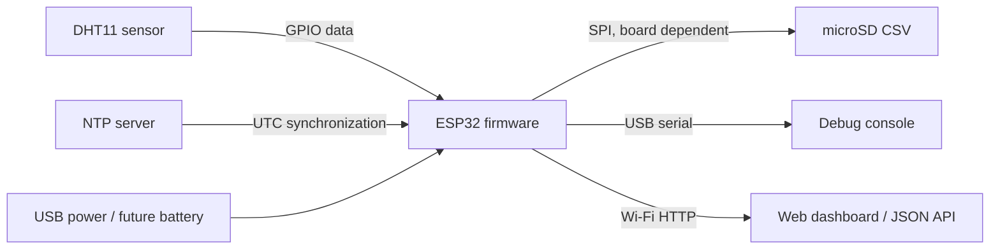

# ESP32 Environmental Data Logger

**C++ · ESP32 · Environmental Sensing · microSD · Wi-Fi · Embedded Systems**

A modular environmental monitoring firmware project built around an ESP32, a DHT11 temperature/humidity sensor, and removable microSD storage. The repository includes an integrated Arduino/C++ implementation with CSV logging, serial diagnostics, an HTTP dashboard, JSON telemetry, optional NTP timestamps, and an optional deep-sleep mode.


## Features

| Feature | Implementation | Hardware validation |
|---|---|---|
| Temperature / humidity | DHT11 sensor via GPIO | Sensor readings previously confirmed |
| microSD initialization | SPI SD driver, configurable pins | Standalone SD mounting previously confirmed |
| CSV logging | Append records, write header, flush/close |validated |
| Live dashboard | ESP32 HTTP server at `/` | validated |
| JSON API | `GET /api/status` | To validated |
| CSV download | `GET /download` | validated |
| UTC timestamps | NTP when Wi-Fi/time available; otherwise blank | validated |
| Offline operation | Continues logging without Wi-Fi | validated |
| Deep sleep | Optional timed wake and log | validated |

## Architecture



## Hardware

- ESP32 development board on SunFounder extension board with microSD slot
- Bare 4-pin DHT11 sensor
- 10 kΩ pull-up resistor between DHT11 VCC and DATA
- microSD card, breadboard/jumpers, USB cable

**DHT11 pinout:** Front grille toward you, pins down: `VCC | DATA | NC | GND`. Connect VCC to 3.3 V, DATA to GPIO 4, GND to GND; leave NC unconnected. See [hardware notes](docs/hardware.md).

**Critical SD note:** The included SPI pin values are *common ESP32 VSPI defaults*, not verified for your SunFounder extension board. Check the board's SD slot schematic or copy the settings from your working SD mount sketch. If the slot uses SD_MMC, adapt the storage interface rather than using SPI. A 128 GB card may require FAT32 formatting; back up data before formatting.

## Getting started

1. Install Arduino IDE, the Espressif ESP32 board package, **Adafruit DHT sensor library**, and **Adafruit Unified Sensor**.
2. Open `firmware/EnvironmentalLogger/EnvironmentalLogger.ino`.
3. Edit `config.h` to match your sensor GPIO and **verified SD-card pin mapping**.
4. Copy `secrets.example.h` to `secrets.h`, enter Wi-Fi credentials, and **never commit `secrets.h`**. Or set `ENABLE_WIFI` to `0` in `config.h` for offline logging (no secrets file required).
5. Insert an appropriately formatted microSD card. Upload normally (arrow icon, not debugger) and open Serial Monitor at 115200 baud.
6. Look for `SD ready`, `Sample: ...`, and `CSV append OK`. If Wi-Fi connects, open the IP address shown in Serial Monitor.
7. Open `/api/status` to inspect telemetry or `/download` to retrieve the CSV.

### CSV schema

```csv
timestamp_utc,uptime_ms,temperature_c,humidity_pct
2026-11-23T18:00:00Z,2000,24.0,42.0
2026-11-23T18:00:02Z,4000,24.0,43.0
```

**Example only:** Values above are synthetic, not measurements. If NTP is unavailable, `timestamp_utc` is blank; `uptime_ms` resets on reboot. The code appends one line per valid sample and flushes after each write. `successful_samples` in the API counts writes since the current boot, not lifetime total.

## Operating modes

**Continuous logging (default):** `SAMPLE_INTERVAL_MS = 2000`; serves a live dashboard while recording sensor readings. Wi-Fi connection is optional for storage.

**Deep sleep (optional):** Set `ENABLE_DEEP_SLEEP = 1` and `DEEP_SLEEP_SECONDS = 60`. Each wake boots the ESP32, initializes peripherals, samples once, logs once, then sleeps. The web dashboard is unavailable in this mode. Boot/setup overhead means the effective interval is **longer than** the configured sleep duration; verify power and timing on hardware.

## Repository layout

```text
firmware/EnvironmentalLogger/  Arduino sketch, configuration, credential template
docs/                          Hardware, verification plan, engineering decisions
examples/                      Synthetic example CSV
assets/                        Placeholder for real photos and plots
scripts/                       CSV quality-check utility
.github/workflows/             Python CSV validation workflow
```

## Validation and results

See [validation checklist](docs/validation.md) for the exact test procedure and a table to record measured results. No 24-hour run, battery lifetime, current draw, or fabricated PCB is claimed. For a stronger portfolio, add actual board photos, CSV exports, measured error rates, and current measurements.

## Engineering tradeoffs

- DHT11 has limited accuracy and update rate; 2-second sampling is a conservative starting point.
- Per-record SD flush favors persistence over throughput and energy efficiency.
- Wi-Fi enables time sync and a dashboard but raises power consumption.
- Deep sleep saves power between wake cycles but restarts the MCU and disables always-on HTTP serving.
- SPI vs SD_MMC depends on the physical board, not the ESP32's default pin labels.


## License

MIT. See [LICENSE](LICENSE).
